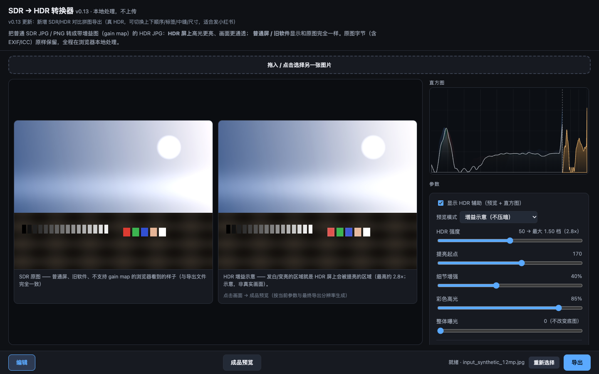
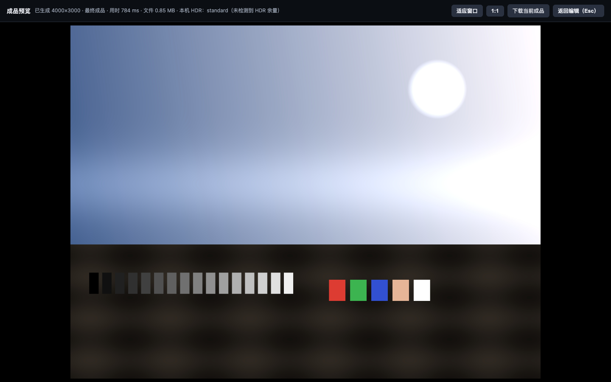
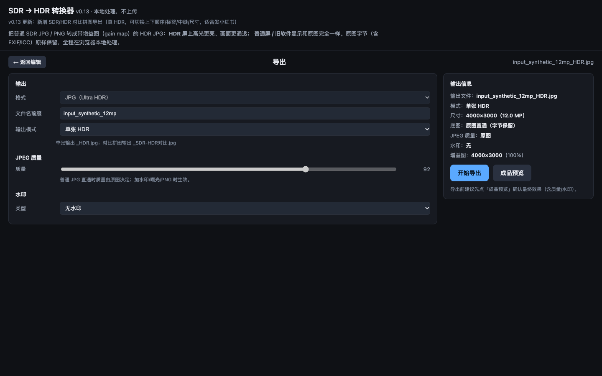
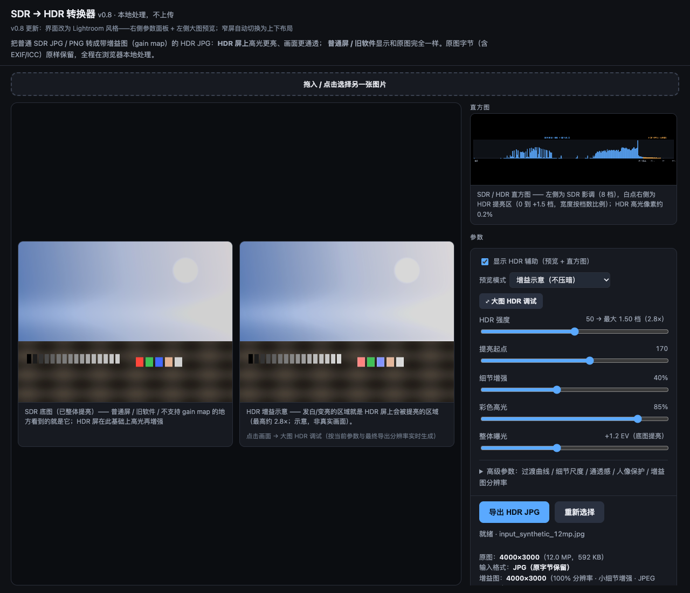
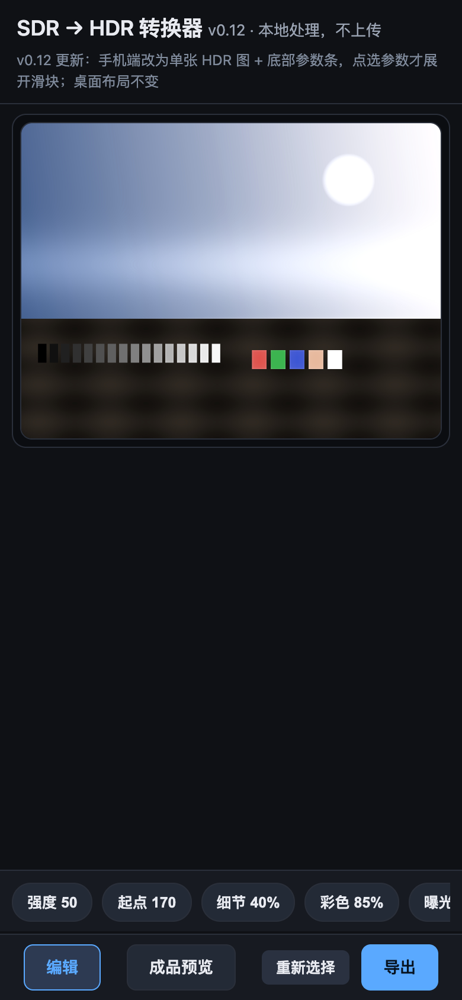
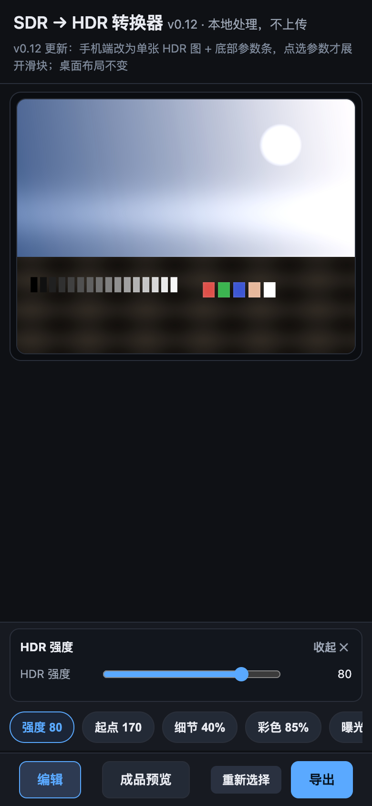
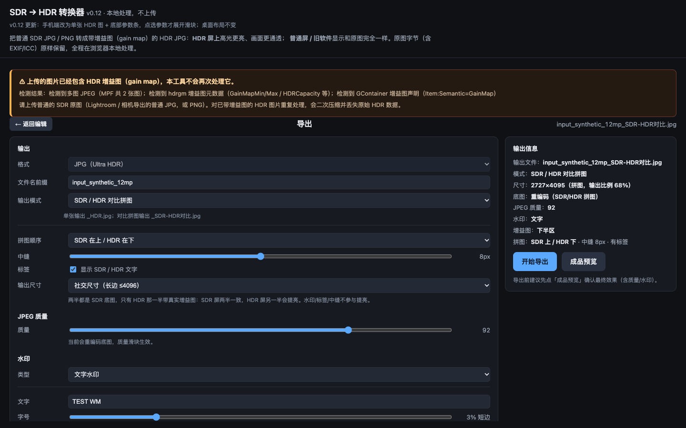
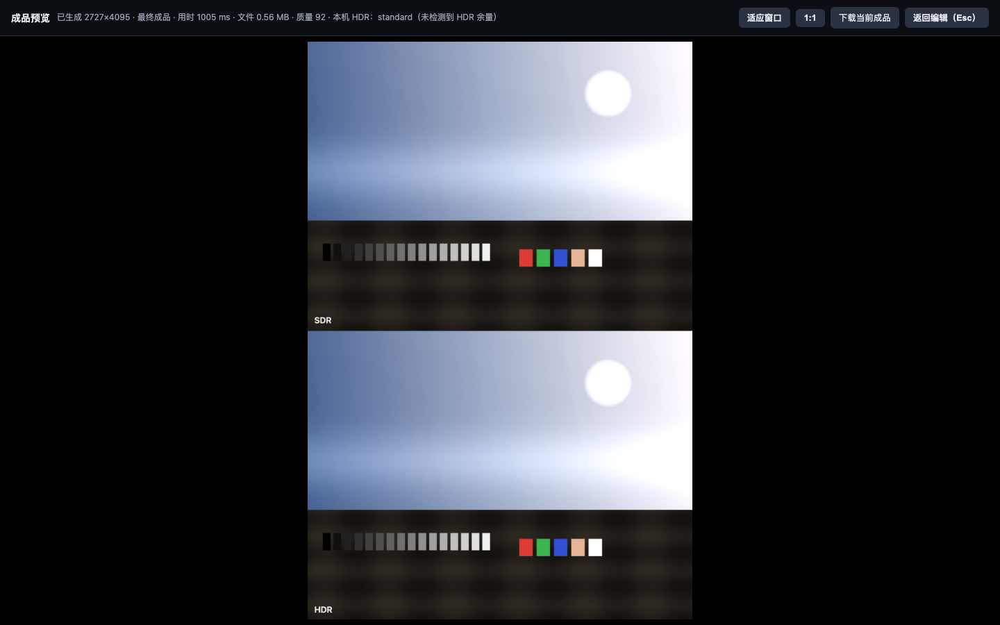

# SDR → HDR 转换器（单文件网页版）

**SDR to HDR gain-map converter — a single-file, local-only web app that turns ordinary SDR JPG/PNG photos into HDR JPEGs with a gain map (Ultra HDR style).**

把普通 SDR 照片（JPG/PNG）转成带增益图（gain map）的 HDR JPG：HDR 屏上高光更亮、画面更通透；普通屏/旧软件显示原始（或已提亮的）SDR 画面。全程在浏览器本地处理，不上传任何文件。

- 单文件 `index.html`，零依赖、离线可用（推荐 Chrome / Edge / Safari）
- 输出为真实 Ultra HDR JPG（主图 + 增益图 + XMP/MPF 元数据），可在 Chrome / Edge / iOS 18+ / macOS 等支持设备上以 HDR 显示
- JPG 输入时原始字节完整保留（EXIF/ICC 不动），只是追加增益图
- 提供 HDR 参数：整体曝光、HDR 强度、提亮起点、细节增强、彩色高光、过渡曲线、细节尺度、通透感、人像保护、增益图分辨率
- 界面参考 Lightroom：**左侧大图预览 + 右侧直方图/参数面板**，底部导航「编辑 / 成品预览 / 导出」
- **直方图**：平滑 RGB 通道 + 亮度曲线，铺满整个卡片；悬停查看亮度/提亮档数与像素占比
- **参数悬停说明**：鼠标停在任意滑块/选项上会显示该参数具体影响画面的什么内容
- **手机端**：只显示 HDR 图 + 底部参数条（核心 5 项 + 高级），点选参数才展开滑块；底部导航同桌面
- **独立导出界面**：JPEG 质量（70–100，仅重编码底图时生效）、文字水印 / 图片 Logo 水印（后加在 SDR 层，不参与 HDR 提亮）
- **成品预览**：全屏显示最终导出字节（含质量/水印设置），按最终分辨率原生渲染
- **SDR/HDR 对比拼图**：导出上下对照图（真 HDR：HDR 一半带真实增益图），可切换顺序、标签、中缝与输出尺寸，适合分享
- **上传校验**：自动识别已带增益图的 HDR JPEG（hdrgm / GContainer / ISO 21496-1 + MPF 多图结构），提示错误并拒绝重复处理
- 点击编辑页画面也可进入成品预览，支持适应窗口 / 1:1、下载当前成品
- 本机 HDR 能力检测（`dynamic-range` 媒体查询），支持"真 HDR 预览"

## 在线使用

部署后可直接打开（推荐在 HDR 屏上用 Safari / Chrome）：

```
https://tianqiQWQ.github.io/sdr2hdr-gainmap/
```

也可以下载 [Releases](../../releases) 里的 zip，解压后双击 `SDR-to-HDR.html` 使用。

## 截图

| Lightroom 风格主界面（底部导航） | 成品预览（全屏） |
|---|---|
|  |  |

| 独立导出界面（质量 / 水印） | 整体曝光模式 |
|---|---|
|  |  |

| 手机端（单图 + 参数条） | 手机端参数面板 |
|---|---|
|  |  |

| SDR/HDR 对比拼图（导出设置） | 对比拼图成品预览 |
|---|---|
|  |  |

## 快速开始

1. 打开 `index.html`（双击，或把文件拖进 Chrome / Edge / Safari）
2. 拖入 / 选择一张 **JPG 或 PNG**
3. 调整参数（右侧预览与 SDR/HDR 直方图会实时变化；点击右侧画面可进入大图调试）
4. 点「导出 HDR JPG」，得到 `原名_HDR.jpg`
5. 传到 HDR 设备上查看（iPhone 照片 App / Android 14+ / Windows HDR / Mac XDR 等）

> 普通 SDR 屏上"看起来没变化"是正常现象：普通预览画布只能显示 SDR 亮度，真实 HDR 效果需要 HDR 屏 + 支持的浏览器/相册。

## 主要参数

| 参数 | 默认 | 作用 |
|---|---|---|
| HDR 强度 | 50 | 最亮处比 SDR 白亮几倍（100 ≈ 8×） |
| 提亮起点 | 170 | 从多亮开始提亮；调低→中间调也参与，调高→只提亮灯/天空/白墙 |
| 细节增强 | 40% | 小结构（雨丝/树叶/反光/文字）额外提亮力度 |
| 彩色高光 | 85% | 红/蓝灯光、霓虹等彩色高光参与程度 |
| **整体曝光** | 0 EV | 类似 PS 32-bit 拉曝光：整张 SDR 底图一起提亮，高光软肩压缩；背景/中间调变亮 |
| 过渡曲线 | 1.6 | 从起点到纯白的过渡（1.0 柔 ↔ 3.0 陡） |
| 细节尺度 | 16px | 多小的结构算"小细节" |
| 通透感 | 15% | 大范围明暗层次调制 |
| 人像保护 | 开 50% | 肤色区域降低提亮，避免脸过亮 |
| 高光柔化 | 80% | 曝光模式的高光滚降（0=硬裁剪，80≈PS 自然过渡） |
| 增益图分辨率 | 全分辨率 | 细节最好；半分辨率可显著减小体积 |

## 导出设置（v0.10+）

- **JPEG 质量**：70–100，默认 92。仅当底图需要重编码时生效（加水印 / 整体曝光 / PNG 输入）；普通 JPG 直通模式保留原图字节，质量由原图决定
- **水印**：支持文字与图片 Logo；位置九宫格、边距、字号/缩放、透明度、颜色可调
  - 水印在转换完成后添加在 **SDR 底图**上，对应区域的增益图会被清零 → HDR 屏上水印不会变亮
- **成品预览**：默认全屏显示最终输出（含质量/水印），可直接下载当前成品
- 在导出界面点「成品预览」也会按当前导出设置生成
- **输出模式**：
  - 单张 HDR：普通输出 `原名_HDR.jpg`
  - **SDR / HDR 对比拼图**：`原名_SDR-HDR对比.jpg`，上下两半为同一张 SDR 底图，HDR 那一半带真实增益图；
    可切换 SDR/HDR 上下顺序、标签、中缝（0–16px）、输出尺寸（社交长边 ≤4096 / 原分辨率长边 ≤8192）

## 输入 / 输出格式

- **输入**：JPG（原始字节保留，推荐）；PNG（自动转 JPEG 底图，透明区域铺白、16-bit 降为 8-bit、不保留 PNG 元数据）
- **输出**：`.jpg`，Ultra HDR 兼容的"主图 + 增益图"JPEG。不支持的软件/平台会把它当普通 JPG 显示（内容为 SDR 主图），文件不会损坏

## 为什么需要"成品预览"

页面里的普通预览是 SDR 画布模拟，无法发出 HDR 亮度。点击底部「成品预览」（或编辑页画面）后：

- 直接用**最终导出的字节**（原始 SDR 字节 + 当前参数/增益图分辨率）在浏览器里原生渲染
- 分辨率与导出完全一致（45MP 就是 45MP，慢一点但最接近最终效果）
- 顶部提供适应窗口 / 1:1 / 下载当前成品；Esc 返回编辑。参数与导出设置变化时自动重新生成；编辑仍在主界面进行

如果页面显示「本机 HDR：standard」，说明当前浏览器没有启用 HDR 渲染：macOS 请用 Safari 打开本页，或直接查看导出的 JPG。

## 兼容性

详见 [docs/compatibility.md](docs/compatibility.md)。简要版：

- **查看 HDR 效果**：Chrome / Edge（Windows 需开启系统 HDR）、Safari（macOS XDR / iOS 18+）、Android 14+ 相册/Chrome
- **运行这个工具**：Chrome / Edge / Safari（桌面与移动端浏览器均可打开网页版；移动端体验与限制见文档）
- Firefox 目前不支持 gain map HDR
- 微信/QQ/网页压缩等二次压缩会剥掉增益图，HDR 静默退化（文件本身仍是正常 JPG）

## 开发与测试

见 [docs/development.md](docs/development.md)。简要：

```bash
# 生成程序化测试图（不依赖任何第三方图片）
python3 tools/make_test_images.py

# 用 headless Chrome 对当前页面做编码测试
node tools/test_encode.js '[{"input":"tests/input_synthetic_12mp.jpg","strength":50,"output":"tests/out.jpg"}]'

# 校验输出结构 + 元数据 + 像素/曲线（需要 Pillow、numpy）
python3 tools/validate_output.py --output tests/out.jpg --original tests/input_synthetic_12mp.jpg --strength 50

# 端到端 UI 测试（上传 → 调参 → 大图 → 导出）
node tools/test_ui.js tests/input_synthetic_12mp.jpg
```

## 仓库结构

```
index.html                 单文件工具（核心）
docs/                      原理、兼容性、开发说明
tools/                     测试图生成 / 编码测试 / 校验 / UI 测试
assets/screenshots/        界面截图（程序化合成图，无第三方素材）
.github/workflows/         基础语法检查 CI
```

## 版本更新说明约定

从 v0.7 起，页面在**版本号下方固定显示一行小字**说明本次更新内容；每次发版同步更新该行与 [CHANGELOG.md](CHANGELOG.md)。

## 已知限制

- 从单张 SDR 合成 HDR，已过曝/死白的高光无法"恢复"，只能合理提亮；整体曝光模式会重编码 SDR 底图（不再逐字节保留原图）
- 文件体积会增加（通常 +15%～100%，取决于题材与增益图分辨率）
- 增益图依赖浏览器/相册/系统的支持；部分分享链路会剥离元数据
- 人像保护是基于肤色的启发式检测，暖色物体可能被轻微误判
- 直方图与 SDR 屏预览是近似示意，最终以 HDR 屏为准

## 许可证与致谢

MIT License，见 [LICENSE](LICENSE)。

输出格式基于公开规范与参考实现整理（ISO 21496-1、Adobe Gain Map 规范、Google Ultra HDR / libultrahdr、Skia 解码路径）。仓库内**不包含任何第三方图片素材**；测试图均由 `tools/make_test_images.py` 程序生成。感谢 libultrahdr、MONOGRID gainmap-js、Skia 等开源项目提供的格式参考。
